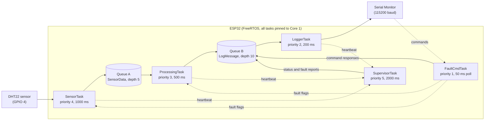
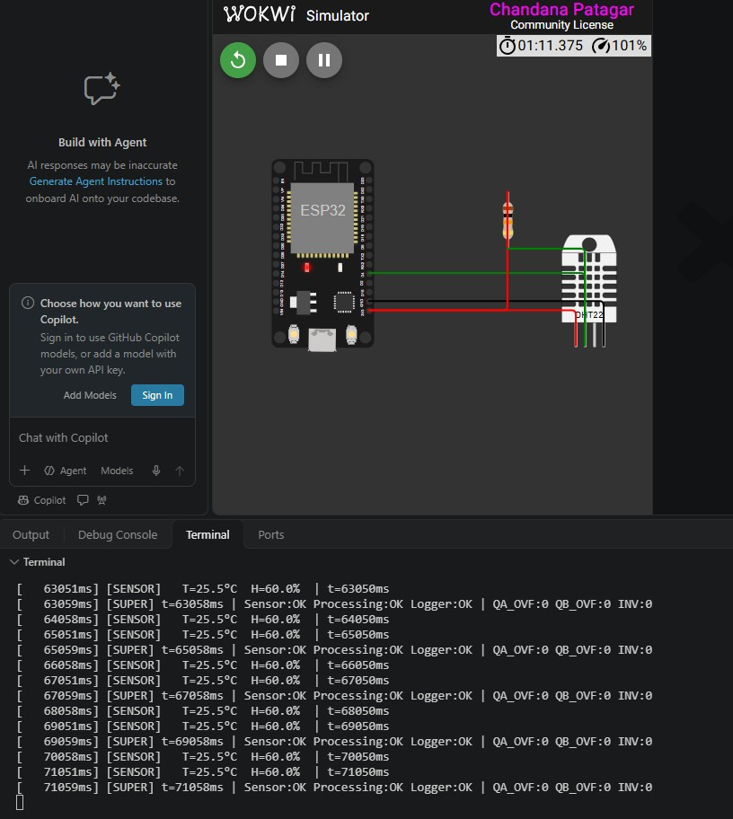
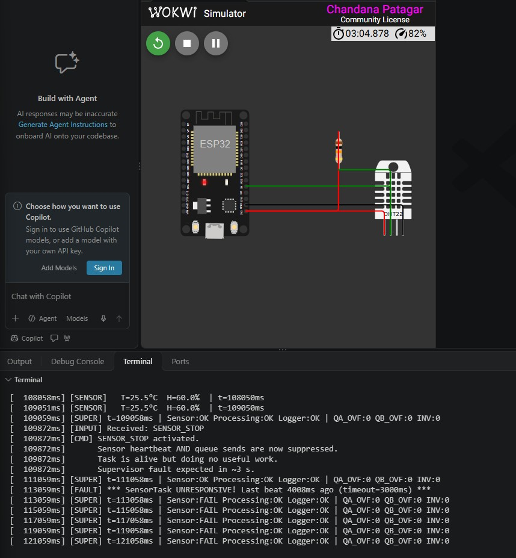
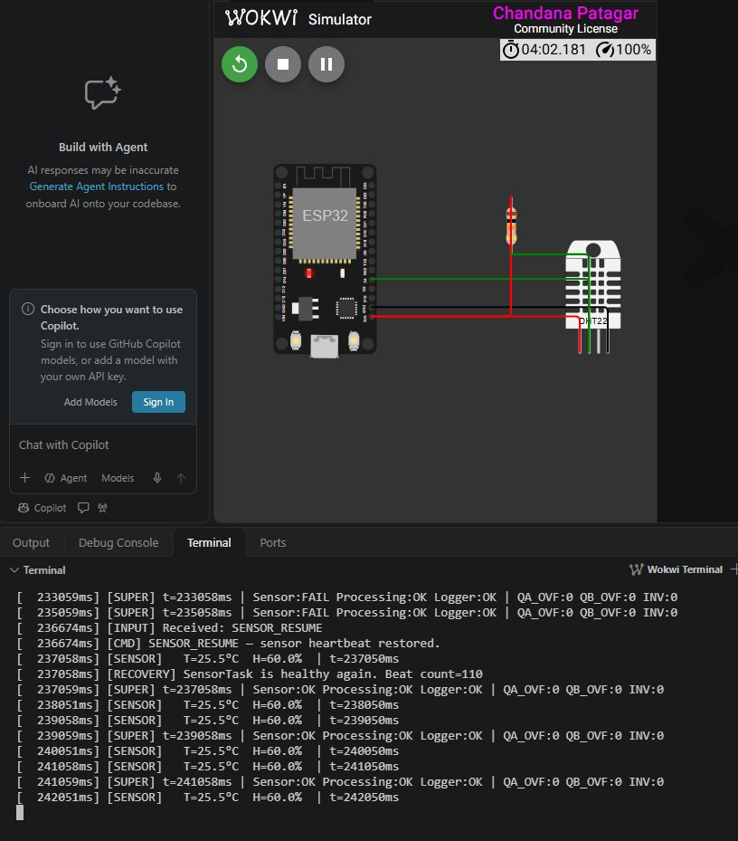
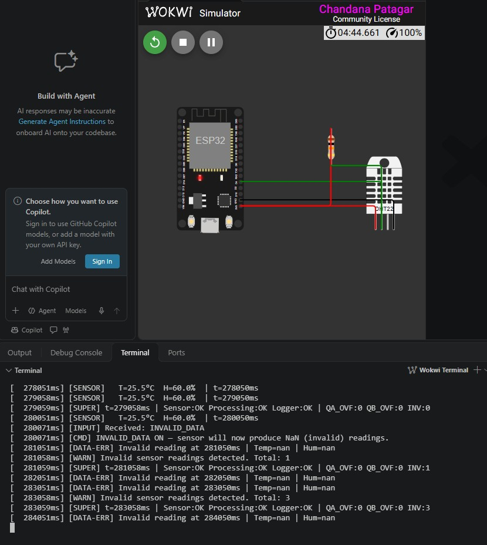
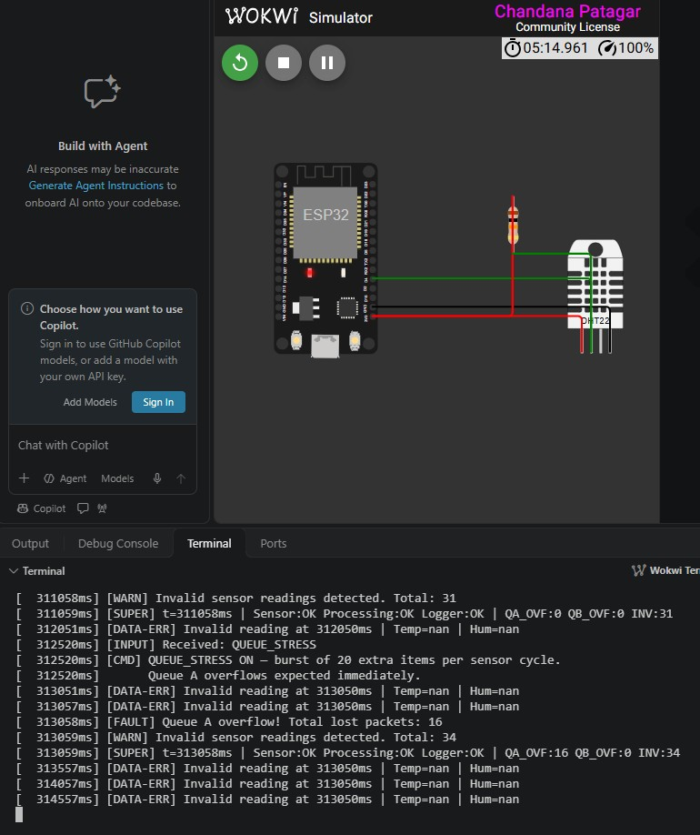
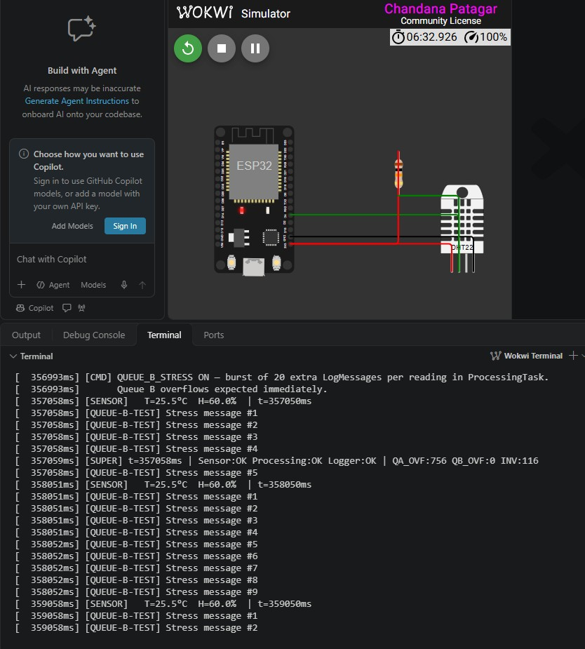

# RTOS Sensor Hub

**Runtime task health monitoring and fault injection for a FreeRTOS-based ESP32 sensor hub, developed and tested in Wokwi simulation.**


> [!NOTE]
> **Scope:** this project was developed and tested in the [Wokwi](https://wokwi.com) simulator. It has **not** been validated on a physical ESP32 or a real DHT22, and no hardware measurements are reported here.

---

## Table of Contents

- [Overview](#overview)
- [Key Features](#key-features)
- [System Architecture](#system-architecture)
- [Simulation Screenshots](#simulation-screenshots)
- [Quick Start](#quick-start)
- [Serial Command Reference](#serial-command-reference)
- [Fault-Injection Walkthrough](#fault-injection-walkthrough)
- [Log Analyser](#log-analyser)
- [Configuration](#configuration)
- [Hardware (Simulated)](#hardware-simulated)
- [Technology Stack](#technology-stack)
- [Project Structure](#project-structure)
- [Troubleshooting](#troubleshooting)
- [Limitations](#limitations)
- [Possible Future Improvements](#possible-future-improvements)

---

## Overview

This project runs five FreeRTOS tasks on an ESP32. A sensor task reads a DHT22 (temperature and humidity), a processing task validates each reading, and a logger task prints everything to the Serial Monitor. A supervisor task watches the other tasks using **heartbeats** and reports when one stops responding.

**Problem it addresses.** In an embedded system, a task that quietly stops doing its job can be harder to notice than one that crashes. A simple way to catch this is for every task to record a timestamp each cycle, and for a supervisor to check how old those timestamps are. This project implements that idea and adds a **Serial command interface** so you can inject faults on purpose and watch the supervisor react.

**What it demonstrates:** task creation and prioritisation, queue-based communication between tasks, periodic scheduling with `vTaskDelayUntil()`, heartbeat monitoring, non-blocking queue sends with overflow counting, and protecting shared data with FreeRTOS critical sections.

## Key Features

- **Five FreeRTOS tasks** with distinct priorities, all pinned to Core 1.
- **Heartbeat monitoring** of the sensor, processing and logger tasks, each with its own timeout.
- **Fault and recovery reporting.** The supervisor reports when a task becomes unresponsive and when it becomes healthy again. It does not restart tasks.
- **Two-queue data pipeline** (`Sensor → Processing → Logger`) using non-blocking sends and overflow counters.
- **Data validation** in the processing task: NaN/infinity checks plus the DHT22 datasheet ranges (-40 to 80 °C, 0 to 100 % RH).
- **Fault injection over Serial** with ten commands: unresponsive sensor, slow sensor, invalid data, and overflow of either queue.
- **Single log writer.** Once the tasks are running, all log output goes through `LoggerTask`, with a millisecond timestamp on every line.
- **Critical-section protection** for shared flags, counters and heartbeat records.
- **Python log analyser** (`log_analyser.py`) for summarising a saved Serial log.
- **No hardware needed.** Runs entirely in Wokwi.

## System Architecture



Solid arrows are queue traffic or data flow. Dotted arrows are shared variables (fault flags and heartbeat records) or Serial input.

### Tasks

Higher number means higher priority. Source files are in [`src/`](src/).

| Task | Priority | Period | Heartbeat timeout | Responsibility | Source |
|------|:--------:|:------:|:-----------------:|----------------|--------|
| `SupervisorTask` | 5 | 2000 ms | not monitored | Checks the three heartbeats, watches overflow and invalid-reading counters, and posts fault, recovery and status messages | [`supervisor_task.cpp`](src/supervisor_task.cpp) |
| `SensorTask` | 4 | 1000 ms | 3000 ms | Reads the DHT22, sends a `SensorData` struct to Queue A, updates its heartbeat | [`sensor_task.cpp`](src/sensor_task.cpp) |
| `ProcessingTask` | 3 | 500 ms | 2000 ms | Waits for Queue A (up to 500 ms), validates the reading, formats a log line, sends it to Queue B | [`processing_task.cpp`](src/processing_task.cpp) |
| `LoggerTask` | 2 | 200 ms | 1000 ms | Drains Queue B and prints each message with a timestamp | [`logger_task.cpp`](src/logger_task.cpp) |
| `FaultCmdTask` | 1 | 50 ms poll | not monitored | Reads Serial commands and sets or clears the fault-injection flags | [`fault_controller.cpp`](src/fault_controller.cpp) |

**Why these priorities.** The supervisor is highest so it gets scheduled promptly even when lower-priority tasks are busy; it spends most of its time blocked and does very little work per cycle. The command task is lowest because a delay of tens of milliseconds is not noticeable for typing commands, and it should not compete with the data pipeline.

### Queues

| | Queue A | Queue B |
|---|---------|---------|
| **Direction** | `SensorTask` → `ProcessingTask` | `ProcessingTask`, `SupervisorTask`, `FaultCmdTask` → `LoggerTask` |
| **Item type** | `SensorData` (temperature, humidity, timestamp, valid flag) | `LogMessage` (text up to 160 characters, timestamp) |
| **Depth** | 5 | 10 |
| **Sender behaviour** | Non-blocking (timeout 0). A failed send increments `g_queue_a_overflow_count` | `ProcessingTask` and `SupervisorTask` are non-blocking. `FaultCmdTask` waits up to 100 ms. Only a failed send from `ProcessingTask` increments `g_queue_b_overflow_count`; other dropped messages are not counted |
| **Receiver behaviour** | `ProcessingTask` blocks for up to 500 ms | `LoggerTask` drains everything available each cycle |

### Heartbeat monitoring

1. Each monitored task writes `millis()` into its heartbeat record every cycle (together with a beat counter, inside one critical section).
2. Every 2000 ms the supervisor takes a snapshot of each record and computes `age = millis() − last_beat_ms`.
3. If `age` exceeds that task's timeout, the supervisor posts one `[FAULT]` message. When the age falls back within the timeout, it posts one `[RECOVERY]` message. It stays silent while the state is unchanged.

**Detection timing.** The supervisor only evaluates heartbeats at its own 2 s checks, so a fault is reported at the first check *after* the timeout has been exceeded, not at the moment of the timeout. For the sensor (3000 ms timeout, 2000 ms checks) this means the reported heartbeat age falls between just over 3 s and 5 s, and the message then passes through Queue B and the logger, which adds up to about one logger period (200 ms). These figures are derived from the constants in [`include/config.h`](include/config.h), not measured. The first supervisor check happens about 2 s after the supervisor starts.

**What a heartbeat proves.** A heartbeat shows that a task's loop reached its heartbeat statement recently. It does not prove the task's output is correct. The processing and logger tasks update their heartbeats *before* they wait on or drain their queues.

### Shared data and synchronisation

Fault-injection flags, overflow and invalid-reading counters, and heartbeat records are shared between tasks. Access to them is protected with **FreeRTOS critical sections** (`portENTER_CRITICAL` / `portEXIT_CRITICAL` using one shared `portMUX_TYPE` lock, `g_shared_mux`). Tasks copy the values they need into local variables inside the critical section and do their slower work (queue sends, string formatting, delays) outside it. The variables are also declared `volatile`, but the critical sections are what provide the protection. Sensor and log data passed between tasks goes through FreeRTOS queues, not shared variables. See the comments in [`include/config.h`](include/config.h).

## Simulation Screenshots

All captures are from the Wokwi simulator, with the Serial Monitor output shown in the terminal panel. Counters are cumulative since boot, so later captures include totals from earlier tests.

### 1. Normal Operation



Sensor readings arrive about once per second and a `[SUPER]` status line about every two seconds, with all three monitored tasks `OK` and all counters at zero.

### 2. Sensor Fault Detection



After `SENSOR_STOP` the sensor lines stop. In this run the command was received at t = 109872 ms and the `[FAULT]` line appeared at t = 113059 ms with a reported beat age of 4008 ms, which is the supervisor's check after the 3000 ms timeout was exceeded. `Sensor:FAIL` continues in the status lines while `Processing` and `Logger` stay `OK`.

### 3. Sensor Recovery



`SENSOR_RESUME` restores the heartbeat and data flow. The supervisor reports `[RECOVERY]` at its next check and the status line returns to `Sensor:OK`.

### 4. Invalid Sensor Data



With `INVALID_DATA` on, each reading produces a `[DATA-ERR]` line while the sensor stays `OK` (its heartbeat is still being updated). The supervisor reports the running total in a `[WARN]` line once per check, not once per reading.

### 5. Queue A Overflow



`QUEUE_STRESS` causes sends to Queue A to fail, and the supervisor reports `[FAULT] Queue A overflow!` with the lost-packet total, which also appears as `QA_OVF` in the status line. `INVALID_DATA` was still switched on when this was captured, which is why `[DATA-ERR]` lines are also visible.

### 6. Queue B Overflow



`QUEUE_B_STRESS` makes `ProcessingTask` push bursts of `[QUEUE-B-TEST]` messages into Queue B for every reading. The earlier `QA_OVF` and `INV` totals are still shown in the status line because counters are not reset.

## Quick Start

### Prerequisites

- [Visual Studio Code](https://code.visualstudio.com)
- The **PlatformIO IDE** extension ([install guide](https://platformio.org/install/ide?install=vscode))
- The **Wokwi Simulator** extension for VS Code ([getting started](https://docs.wokwi.com/vscode/getting-started)). It asks you to activate a licence on first use.

### Run it

```bash
# 1. Clone the repository
git clone https://github.com/ChandanaP30/RTOS-Sensor-Hub.git
cd RTOS-Sensor-Hub

# 2. Open it in VS Code
code .

# 3. Build the firmware (the first build downloads the toolchain and libraries)
pio run
```

You can also build with the PlatformIO check-mark button in the status bar instead of `pio run`.

4. Press **F1** and run **Wokwi: Start Simulator**. [`wokwi.toml`](wokwi.toml) tells Wokwi to load the firmware from `.pio/build/esp32dev/`, so step 3 must finish first.
5. Open the simulator's Serial Monitor. You should see a startup banner, then a sensor line roughly every second and a `[SUPER]` status line every 2 seconds.

Each log line is prefixed with a millisecond timestamp. The first lines look like this:

```
========================================
  RTOS Sensor Hub — Runtime Task Health
========================================
Initialising FreeRTOS objects...

[INIT] Queues created OK
[INIT] All tasks created. Scheduler running.

Type HELP for available commands.
```

Followed by lines of this form (illustrative; timestamps and exact order will differ):

```
[SENSOR]   T=25.5°C  H=60.0%  | t=<ms>ms
[SUPER] t=<ms>ms | Sensor:OK Processing:OK Logger:OK | QA_OVF:0 QB_OVF:0 INV:0
```

The simulated DHT22 is set to 25.5 °C and 60.0 % in [`diagram.json`](diagram.json).

## Serial Command Reference

Type a command in the Wokwi Serial Monitor input box and press Enter. Commands are case-insensitive. The firmware echoes each command as `[INPUT] Received: <COMMAND>`, and replies to an unrecognised command with `Type HELP for the command list.`

The command task starts polling Serial about one second after boot, so wait a moment after the simulator starts.

| Command | Behaviour | Effect |
|---------|-----------|--------|
| `HELP` | action | Prints the command list |
| `STATUS` | action | Prints every flag, the three counters, each task's beat count, and the age of the sensor's last heartbeat |
| `SENSOR_STOP` | sets flag | `SensorTask` keeps looping at its normal period but skips its heartbeat update **and** its Queue A send. Simulates an unresponsive task; see the note below |
| `SENSOR_RESUME` | clears flag | Ends `SENSOR_STOP` |
| `SENSOR_SLOW` | sets flag | Inserts a 3000 ms delay at the start of each sensor cycle, giving an effective period of about 4 s |
| `SENSOR_NORMAL` | clears flag | Ends `SENSOR_SLOW` |
| `INVALID_DATA` | **toggle** | Sensor produces NaN readings; `ProcessingTask` flags them and counts them |
| `QUEUE_STRESS` | **toggle** | After its normal send, `SensorTask` pushes 20 extra items into Queue A each cycle |
| `QUEUE_B_STRESS` | **toggle** | For every reading it handles, `ProcessingTask` pushes 20 extra `[QUEUE-B-TEST]` messages into Queue B |
| `RESET_FAULTS` | clears all | Clears all five fault flags. The overflow and invalid-reading counters are **not** reset |

> [!IMPORTANT]
> `SENSOR_STOP` **simulates** an unresponsive sensor task. It does not crash, delete or permanently hang the task. The task continues to loop; it just stops updating its heartbeat and stops sending data, which is what the supervisor is designed to notice. `SENSOR_RESUME` returns it to normal.

## Fault-Injection Walkthrough

Start the simulator and let it run for a few seconds so the system is in its normal state. Lines below omit the timestamp prefix, and `<N>` marks values that vary from run to run.

### 1. Unresponsive sensor (`SENSOR_STOP`)

1. Type `SENSOR_STOP`.
2. The sensor lines stop appearing. The processing and logger tasks keep running and keep their heartbeats.
3. At the supervisor's next check after the sensor's heartbeat is older than 3000 ms, you will see:
   ```
   [FAULT] *** SensorTask UNRESPONSIVE! Last beat <N>ms ago (timeout=3000ms) ***
   [SUPER] t=<N>ms | Sensor:FAIL Processing:OK Logger:OK | QA_OVF:0 QB_OVF:0 INV:0
   ```
   The firmware's own reply to the command says "~3 s"; as described under [Heartbeat monitoring](#heartbeat-monitoring), the actual delay depends on where the supervisor's 2 s checks fall.
4. Type `SENSOR_RESUME`. The sensor resumes on its next cycle, and the supervisor reports it at its next check:
   ```
   [RECOVERY] SensorTask is healthy again. Beat count=<N>
   ```

### 2. Slow sensor (`SENSOR_SLOW`)

1. Type `SENSOR_SLOW`. The sensor now beats about every 4 s, which is longer than its 3 s timeout.
2. Watch the `[SUPER]` lines. Because the sensor's 4 s period and the supervisor's 2 s checks line up in a fixed pattern that depends on timing at the moment you issue the command, the supervisor may report `[FAULT]` and `[RECOVERY]` alternately, or may not flag the sensor at all. This follows from the constants in `config.h` and is a consequence of the supervisor's polling interval; see [Limitations](#limitations).
3. Type `SENSOR_NORMAL` to restore the normal 1 s period.

### 3. Invalid readings (`INVALID_DATA`)

1. Type `INVALID_DATA` (type it again to turn it off).
2. The sensor still updates its heartbeat, so it stays `OK`, but every reading is invalid:
   ```
   [DATA-ERR] Invalid reading at <N>ms | Temp=nan | Hum=nan
   ```
3. At each supervisor check where the count has changed, you will also see:
   ```
   [WARN] Invalid sensor readings detected. Total: <N>
   ```
   This shows the difference between a task that is not responding and a task that is responding with bad data.

### 4. Queue A overflow (`QUEUE_STRESS`)

1. Type `QUEUE_STRESS` (again to turn it off).
2. The sensor pushes one reading plus 20 extra copies per cycle into a queue of depth 5, while `ProcessingTask` removes at most one item per 500 ms period, so sends fail and are counted.
3. At supervisor checks where the counter has changed:
   ```
   [FAULT] Queue A overflow! Total lost packets: <N>
   ```

### 5. Queue B overflow (`QUEUE_B_STRESS`)

1. Type `QUEUE_B_STRESS` (again to turn it off).
2. `ProcessingTask` sends a burst of `[QUEUE-B-TEST] Stress message #<n>` lines for every reading it handles. They are non-blocking sends, so once Queue B (depth 10) is full the rest are dropped and counted:
   ```
   [FAULT] Queue B overflow! Total lost log messages: <N>
   ```
3. `QA_OVF` stays unchanged in the `[SUPER]` line, so only Queue B is under pressure. Because the supervisor and command task also send through Queue B, some of their messages may be dropped while this fault is active.

### 6. Clearing everything (`RESET_FAULTS`)

Type `RESET_FAULTS`. All fault flags are cleared and the system returns to normal operation; if the sensor had been flagged, a `[RECOVERY]` line follows at the next supervisor check. Overflow and invalid-reading totals keep their values because they count events since boot.

## Log Analyser

[`log_analyser.py`](log_analyser.py) summarises a saved Serial log. It needs Python 3 and uses only the standard library.

1. Run a session in Wokwi, then copy the Serial Monitor output into a text file named `serial_log.txt` in the project folder.
2. Run:
   ```bash
   python log_analyser.py              # reads serial_log.txt
   python log_analyser.py mylog.txt    # or give a file name
   ```

The report includes:

- Count of valid and invalid readings, and min / max / average temperature and humidity
- Sensor reading intervals (min, max, average) compared with the nominal 1000 ms
- Number of `[FAULT]` and `[RECOVERY]` lines, and the beat age reported for each unresponsive task
- Time from the first `SENSOR_STOP` command in the log to the first `UNRESPONSIVE` line
- Maximum Queue A and Queue B overflow counts seen
- The commands received, and how often each task was `OK` across supervisor cycles

The analyser matches the exact log formats printed by the firmware with regular expressions, so if you change the log messages in `src/`, update the patterns at the top of the script too.

## Configuration

Timing, priorities, queue depths and thresholds are defined in [`include/config.h`](include/config.h).

| Setting | Value |
|---------|-------|
| DHT22 data pin / type | GPIO 4 / DHT22 |
| Serial baud rate | 115200 |
| Queue depths | Queue A: 5, Queue B: 10 |
| Log message length | 160 characters |
| Task periods | Sensor 1000 ms, Processing 500 ms, Logger 200 ms, Supervisor 2000 ms |
| Heartbeat timeouts | Sensor 3000 ms, Processing 2000 ms, Logger 1000 ms |
| Task stack sizes (bytes) | Sensor 4096, Processing 3072, Logger 4096, Supervisor 3072, FaultCmd 3072 |
| `SENSOR_SLOW` extra delay | 3000 ms |
| Stress bursts | 20 items (Queue A), 20 items (Queue B) |

The valid temperature (-40 to 80 °C) and humidity (0 to 100 %) limits are constants at the top of [`src/processing_task.cpp`](src/processing_task.cpp). Build settings (board `esp32dev`, Arduino framework, 115200 monitor speed, library dependencies) are in [`platformio.ini`](platformio.ini).

## Hardware (Simulated)

The circuit is defined in [`diagram.json`](diagram.json) and runs only in Wokwi. No physical wiring has been built or tested.

| Part | Wokwi type | Connection |
|------|------------|------------|
| ESP32 DevKit V1 | `wokwi-esp32-devkit-v1` | n/a |
| DHT22 sensor | `wokwi-dht22` | VCC to 3V3, GND to GND, SDA to GPIO 4 (`D4`) |
| 10 kΩ resistor | `wokwi-resistor` | Between 3V3 and the DHT22 data line (pull-up) |

## Technology Stack

| Area | Technology |
|------|------------|
| Microcontroller | ESP32 (DevKit V1 profile, simulated) |
| RTOS | FreeRTOS, as bundled with the ESP32 Arduino core |
| Language | C++ (Arduino framework) |
| Sensor library | [Adafruit DHT sensor library](https://github.com/adafruit/DHT-sensor-library) `^1.4.6` and Adafruit Unified Sensor `^1.1.14` |
| Build system | PlatformIO (`espressif32` platform) |
| Simulation | Wokwi for VS Code |
| Tooling | Python 3 (log analysis, standard library only) |

## Project Structure

```
RTOS-Sensor-Hub/
├── platformio.ini            # Board, framework, library dependencies
├── diagram.json              # Wokwi circuit (ESP32, DHT22, 10 kΩ resistor)
├── wokwi.toml                # Points Wokwi at the built firmware
├── log_analyser.py           # Offline Serial log analysis
├── docs/                     # Wokwi simulation screenshots used in this README
├── include/
│   └── config.h              # Constants, shared structs, extern declarations
└── src/
    ├── main.cpp              # setup(), queue and task creation, global objects
    ├── sensor_task.cpp       # DHT22 read, Queue A sender, heartbeat
    ├── processing_task.cpp   # Validation, Queue B sender, heartbeat
    ├── logger_task.cpp       # Serial output, heartbeat
    ├── supervisor_task.cpp   # Heartbeat checks, fault and recovery reports
    └── fault_controller.cpp  # Serial command handler, fault flags
```

## Troubleshooting

| Problem | What to try |
|---------|-------------|
| Wokwi cannot find the firmware | Run `pio run` first. Wokwi loads `.pio/build/esp32dev/firmware.bin` (see [`wokwi.toml`](wokwi.toml)) |
| `pio` is not recognised in a terminal | Use a terminal opened from the PlatformIO extension, or the build button in the VS Code status bar |
| First build is slow or fails to download | PlatformIO downloads the ESP32 toolchain and libraries on first use and needs an internet connection |
| Wokwi asks for a licence | Follow the activation prompt from the Wokwi extension (see its [getting-started guide](https://docs.wokwi.com/vscode/getting-started)) |
| Typed commands get no response | Wait a second after boot, click into the Serial Monitor input box, and press Enter after the command |
| `Unknown command` reply | Check the spelling against [the command table](#serial-command-reference); commands are case-insensitive but names must match exactly |
| A message you expected is missing from the log | Supervisor and command messages are dropped if Queue B is full (see [Limitations](#limitations)) |

## Limitations

- **Simulation only.** The project has been developed and tested in Wokwi, not on physical hardware. Real DHT22 timing and failure modes, real UART timing and real scheduler behaviour have not been evaluated. Timing values observed in the simulator should not be treated as representative of a real board, and this README reports no timing measurements.
- **No timing guarantees.** Tasks are scheduled periodically with FreeRTOS, but the project does not claim deterministic or jitter-free behaviour and has not measured jitter.
- **Detection granularity.** The supervisor polls every 2 s, so fault reports are quantised to its check times (see [Heartbeat monitoring](#heartbeat-monitoring)). With the current constants, `SENSOR_SLOW` (about 4 s per heartbeat against a 3 s timeout) can be reported as alternating fault/recovery or can go unflagged, depending on how the checks line up. Detecting slower-than-expected tasks reliably would need a shorter polling period, a different timeout, or a different method.
- **Detection and reporting only.** The supervisor does not restart or repair a task. Task handles are not stored, so there is no restart path.
- **Simulated faults only.** `SENSOR_STOP` and the other injected faults are controlled by flags in the code. Real failures such as a genuine hang, deadlock or stack overflow have not been tested.
- **Limited coverage.** Only the sensor, processing and logger tasks have heartbeats. The supervisor and command tasks are not monitored, and no hardware watchdog is used, so nothing detects a stalled supervisor.
- **Liveness, not correctness.** A heartbeat shows a task is reaching its heartbeat point. Output correctness is checked only through the processing task's validity tests.
- **Dropped diagnostics under load.** Supervisor messages are sent without waiting, and command-task messages wait at most 100 ms, so either can be dropped if Queue B is full. The Queue B overflow counter only counts failed sends from `ProcessingTask`, not these dropped messages.
- **Cumulative counters.** Overflow and invalid-reading counters count events since boot and are not reset by `RESET_FAULTS`.
- **Log-format dependency.** `log_analyser.py` parses the firmware's current message formats and must be updated if they change.
- **Toolchain not pinned.** `platformio.ini` does not pin the `espressif32` platform version, so future platform releases may change build behaviour.
- **Not certified.** This is an educational project. It has not been certified or validated for safety-critical use.

## Possible Future Improvements

- Validate the firmware on a physical ESP32 with a real DHT22 and record real timing behaviour.
- Store task handles so the supervisor can restart a failed task.
- Use the ESP32 hardware or task watchdog so a stalled supervisor is also detected.
- Reduce the supervisor's polling period or add per-task slow-cycle detection to improve detection of slow tasks.
- Log fault events to non-volatile storage (NVS or SPIFFS) so they survive a reset.
- Monitor stack usage with `uxTaskGetStackHighWaterMark()`.
- Add a `RESET_COUNTERS` command.
- Add LED status indicators, or send fault data to an MQTT broker.
- Replace polling with FreeRTOS software timers where appropriate.
